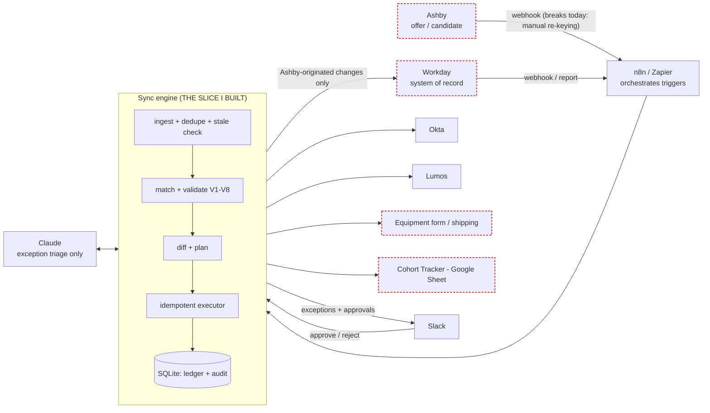

# Systems map

Red dashed = where data breaks today (changes made after the offer don't reach downstream systems reliably).

| System | Data owned | How it changes | Failure mode today |
|---|---|---|---|
| Ashby | Candidate, offer, start date, shipping address (pre-hire) | Recruiter edits after offer | Edits never reach Okta/IT/Tracker; stale copies |
| Workday | Worker record, manager, location (system of record) | HR edits; off-cycle hires created directly | Off-cycle hires invisible to other systems; Ashby/Workday drift |
| Okta | Login, display name, groups, activation date | Provisioned from hire data | Wrong login/name if source changed; active-account renames are risky |
| Lumos | App bundle, access schedule, approver | Requested per role/location/manager | Wrong bundle/approver after location or manager change |
| Equipment (IT form) | Hardware request, ship-to, ship-by, shipped flag | Manual form | Laptop shipped to old address / too late |
| Cohort Tracker | Cohort week, roster row | Manual sheet edits | Silent drift, duplicate rows |
| Slack | Exceptions, approvals | Human clicks | Exceptions lost in channel noise |
| n8n | Triggers / glue | Workflow edits | No state: retries and ordering are its weak spot |
